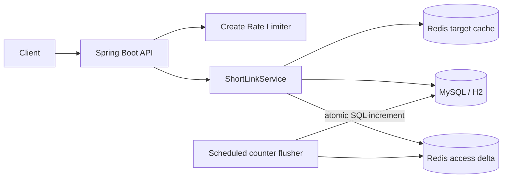

# ShortLink Platform

2026-10-04 已补生成短码负缓存失效及提交后缓存清理，新增回归测试；本机 Java 17 工具链不可用，本轮未执行 Java 测试。详见 [完善记录与验收](docs/06-完善记录与验收.md)，不能把此修复称为强一致缓存协议。

一个面向学习、实习面试和后续扩展的高并发短链接后端。项目不是简单 CRUD：跳转链路使用 Redis 缓存，空结果使用短 TTL 防止缓存穿透，访问次数先在 Redis 原子累加并批量落库，创建接口同时具备 Redis 与本机降级限流。

## 技术栈

- Java 17、Spring Boot 3、Spring MVC、Spring Data JPA
- MySQL 8、Redis 7、H2（零依赖本地开发）
- Bean Validation、Problem Details、Actuator、OpenAPI/Swagger UI
- JUnit 5、Mockito、Docker Compose、GitHub Actions、k6

## 架构



### 读链路

1. `/r/{code}` 首先读取 `shortlink:target:{code}`。
2. 命中目标地址时直接返回 `302 Found`，避免数据库访问。
3. 未命中时回源数据库；不存在的短码写入 1 分钟空值缓存，降低恶意随机短码造成的缓存穿透。
4. 访问次数通过 Redis `INCR` 累加；定时任务使用原子 `GETSET` 截取增量后，通过单条 SQL 更新数据库。
5. Redis不可用时，跳转会回源数据库，访问计数降级为数据库原子自增，创建限流降级为单实例内存窗口。

### 写链路

1. 校验目标必须是绝对 HTTP/HTTPS URL。
2. 默认生成 8 位 `SecureRandom` Base62 短码，约有 `62^8` 种组合。
3. 数据库唯一索引是最终一致性边界；随机短码发生碰撞时最多重试 6 次。
4. 自定义别名支持字母、数字、下划线和连字符，长度为 4～32。
5. 修改链接状态时主动删除缓存，避免停用链接继续跳转。

## 快速启动

### 方式一：只使用本地Java

要求 JDK 17+ 和 Maven 3.9+。默认使用文件型H2数据库；没有启动Redis时，系统自动使用数据库和本地限流降级路径。

```bash
mvn spring-boot:run
```

应用启动后：

- Swagger UI：<http://localhost:8080/swagger-ui.html>
- OpenAPI JSON：<http://localhost:8080/api-docs>
- 健康检查：<http://localhost:8080/actuator/health>

### 方式二：Docker Compose

要求 Docker 24+ 和 Compose v2：

```bash
docker compose up --build
```

该方式同时启动MySQL、Redis和应用。数据库及Redis数据保存在命名卷中。

## API示例

### 创建短链接

```bash
curl -i -X POST http://localhost:8080/api/v1/links \
  -H "Content-Type: application/json" \
  -d '{
    "originalUrl": "https://spring.io/projects/spring-boot",
    "title": "Spring Boot",
    "customAlias": "springboot",
    "expiresAt": "2027-08-21T00:00:00Z"
  }'
```

响应示例：

```json
{
  "shortCode": "springboot",
  "shortUrl": "http://localhost:8080/r/springboot",
  "originalUrl": "https://spring.io/projects/spring-boot",
  "title": "Spring Boot",
  "status": "ACTIVE",
  "expiresAt": "2027-08-21T00:00:00Z",
  "accessCount": 0,
  "createdAt": "2026-08-21T10:00:00Z"
}
```

### 访问、查询、统计和停用

```bash
curl -i http://localhost:8080/r/springboot
curl http://localhost:8080/api/v1/links/springboot
curl http://localhost:8080/api/v1/links/springboot/stats

curl -X PATCH http://localhost:8080/api/v1/links/springboot/status \
  -H "Content-Type: application/json" \
  -d '{"status":"DISABLED"}'
```

错误响应采用 RFC 9457 Problem Details，例如不存在的短链返回 `404`，已停用或过期返回 `410`，别名冲突返回 `409`，创建限流返回 `429`。

## 测试与压测

运行单元测试和仓储测试：

```bash
mvn clean verify
```

安装 [k6](https://grafana.com/docs/k6/latest/set-up/install-k6/) 后，先创建一个短链，再执行：

```bash
k6 run -e SHORT_CODE=springboot scripts/load-test.js
```

压测脚本默认逐步升至100个虚拟用户，并检查失败率低于1%、P95低于200ms。阈值只是本地实验目标，不是未经验证的性能声明；写简历前应保存自己的机器配置、数据规模和实际结果。

## 配置

常用环境变量：

| 变量 | 默认值 | 说明 |
|---|---:|---|
| `BASE_URL` | `http://localhost:8080/r/` | 对外短链前缀 |
| `CODE_LENGTH` | `8` | 随机短码长度，允许6～12 |
| `CREATE_LIMIT_PER_MINUTE` | `60` | 每客户端每分钟创建上限 |
| `CACHE_TTL` | `24h` | 正常目标缓存时间 |
| `NEGATIVE_CACHE_TTL` | `1m` | 空值缓存时间 |
| `COUNTER_FLUSH_INTERVAL_MS` | `5000` | 访问增量落库周期 |
| `DB_URL` | H2文件数据库 | JDBC URL |
| `REDIS_HOST` | `localhost` | Redis地址 |

## 项目结构

```text
src/main/java/com/interview/shortlink
├── config       配置属性和MVC配置
├── domain       JPA实体与状态
├── dto          API输入输出模型
├── exception    业务异常
├── repository   数据访问和原子计数SQL
├── service      短码、缓存、计数、限流和业务逻辑
└── web          Controller、拦截器和全局异常处理
```

## 可以继续迭代的方向

- 用户体系和链接分组，避免当前匿名创建模型缺少资源归属。
- 使用Snowflake ID转Base62，比较随机短码与发号器的碰撞、可用性及安全差异。
- 使用Redis Lua把“登记活跃短码 + 计数”合并为一次原子操作。
- 将访问明细写入Kafka，再由Flink聚合地区、设备、来源和时间序列。
- 使用ShardingSphere按短码分片，并设计用户维度的路由索引。
- 增加Prometheus registry、Grafana面板、链路追踪与告警。
- 用Flyway管理正式数据库变更，生产环境关闭Hibernate自动建表。
