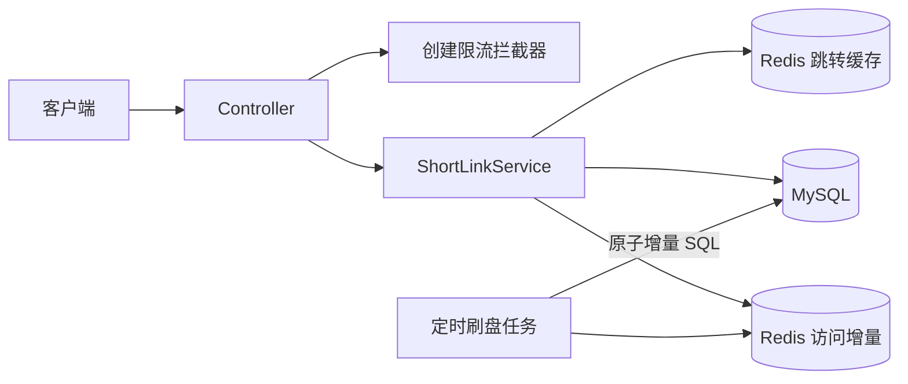

# 短链接平台项目详解

2026-10-04 更新：缓存失效已调整为提交后执行，自动短码也清理负缓存；新增测试本轮因 Java 17 工具链问题未执行。本文历史联调记录不代表最新修复已验收，见 [完善记录](06-完善记录与验收.md)。

## 1. 项目定位

这是一个面向高并发读场景的短链接后端。用户提交长 URL，系统生成短码；访问短码时返回 HTTP 302 跳转。项目重点不在 CRUD，而在热点读取、缓存穿透、访问计数写放大、短码唯一性、限流与降级。

适合投递 Java 后端、服务端研发、中间件应用、基础架构方向实习。面试时应将它讲成“以短链接为业务载体，实践缓存、限流和异步聚合思想”，不要包装成已经承载互联网真实流量的生产系统。

## 2. 技术栈及选择理由

| 技术 | 项目中的职责 | 选择理由 |
|---|---|---|
| Java 17 | 主要开发语言 | LTS 版本，使用 record、文本块等现代语法 |
| Spring Boot 3.5 | 应用装配、配置和生命周期 | 快速构建可运行、可测试、可观测的服务 |
| Spring MVC | REST API 与 302 跳转 | 同步请求模型适合当前业务规模 |
| Spring Data JPA | 实体映射和数据库访问 | 减少模板代码，同时保留自定义原子更新 SQL |
| MySQL 8 | 链接信息与最终访问量 | 唯一索引是短码唯一性的最终约束 |
| Redis 7 | 跳转缓存、空值缓存、访问增量、限流计数 | 低延迟、高吞吐并提供原子操作和 Lua |
| H2 | 无中间件的本地运行与测试 | 降低项目启动门槛，不代表生产选型 |
| Bean Validation | 请求参数校验 | 将格式约束放在 API 边界 |
| Problem Details | 统一错误响应 | 使用标准化错误结构表达 400/404/409/410/429 |
| Actuator/OpenAPI | 健康检查和接口文档 | 便于运维检查与接口调试 |
| Docker Compose | 本地集成环境 | 一条命令启动应用、MySQL、Redis |
| JUnit 5/Mockito/k6 | 单元、仓储和压测 | 验证业务分支、SQL 行为与跳转链路 |

## 3. 总体架构



代码按 `web → service → repository → domain` 分层：

- `web`：HTTP 协议、参数校验、状态码、统一异常转换。
- `service`：短码生成、缓存、访问计数、限流和核心业务。
- `repository`：JPA 查询和数据库原子更新。
- `domain`：链接状态、有效期、访问量等领域数据。
- `config`：类型安全配置和 MVC 拦截器注册。

## 4. 数据模型

核心表 `short_links`：

| 字段 | 含义 | 设计要点 |
|---|---|---|
| `id` | 自增主键 | 内部数据库标识 |
| `short_code` | 对外短码 | 唯一约束，长度最多 32 |
| `original_url` | 原始 URL | 最长 2048，只允许绝对 HTTP/HTTPS 地址 |
| `title` | 标题 | 可选，最长 200 |
| `status` | `ACTIVE`/`DISABLED` | 停用后返回 410 |
| `expires_at` | 过期时间 | 可空；缓存 TTL 不得越过此时间 |
| `access_count` | 已落库访问量 | Redis 待刷增量不包含在该字段内 |
| `created_at/updated_at` | 审计时间 | 使用 UTC `Instant` |

`short_code` 的数据库唯一约束非常重要。应用层的“先判断是否存在”只能改善错误提示，无法消除并发竞态；最终必须依靠数据库约束兜底。

## 5. 创建短链接链路

1. Bean Validation 校验字段长度、别名格式和过期时间。
2. 业务层使用 `URI` 再校验 URL 必须是绝对 HTTP/HTTPS URL，拒绝 `javascript:` 等协议。
3. 如果指定自定义别名，先查询是否存在，然后尝试写库；并发抢占导致的唯一键异常转换为 409。
4. 未指定别名时，通过 `SecureRandom` 从 Base62 字符集中生成 8 位短码。
5. 调用 `saveAndFlush`，让唯一键冲突在当前调用中暴露。
6. 随机碰撞时最多重试 6 次。
7. 创建成功返回 201 和资源地址。

### 为什么使用 8 位 Base62

字符集包含 0-9、A-Z、a-z，共 62 个字符，8 位空间是：

`62^8 = 218,340,105,584,896`，约 2.18×10^14。

空间很大不代表绝对不会碰撞。随机生成存在生日悖论，因此实现仍以唯一索引和重试处理碰撞。`SecureRandom` 比 `Random` 更难预测，也降低别人顺序枚举短码的便利性，但它不等同于完整的访问控制。

### 可替代方案

- 数据库自增 ID 转 Base62：简单且无碰撞，但容易被枚举，依赖中心数据库。
- Snowflake ID 转 Base62：分布式生成能力强，但码更长且需处理时钟回拨。
- 预生成号码池：请求路径快，但系统复杂度更高。

当前项目选择随机码，是在可实现性、不可预测性和面试展示价值之间的折中。

## 6. 跳转读链路

请求：`GET /r/{code}`。

### 缓存命中

1. 查询 `shortlink:target:{code}`。
2. 命中真实 URL，Redis 访问计数加一。
3. 返回 302，设置 `Location`、`Cache-Control: no-store` 和 `Pragma: no-cache`。

### 缓存未命中

1. 回源 MySQL 查询短码。
2. 不存在时，将特殊值 `__NULL__` 写入 Redis，默认 TTL 1 分钟，然后返回 404。
3. 存在但停用或过期，返回 410 Gone。
4. 有效时将 URL 写入缓存，默认 TTL 24 小时。
5. 如果链接剩余有效期小于 24 小时，缓存 TTL 取剩余有效期，避免链接过期后缓存仍可跳转。
6. 记录访问增量并返回 302。

### 为什么使用空值缓存

攻击者可以不断访问随机短码。如果每个不存在的短码都穿透到数据库，会形成缓存穿透。短 TTL 空值缓存可以吸收同一无效短码的重复请求。它无法完全防御每次都随机新短码的攻击，生产系统还需要布隆过滤器、网关限流和风控。

### 当前缓存一致性策略

- 状态变更时主动删除缓存，采用 Cache-Aside 模式。
- 数据库是事实来源，Redis 是可丢失的加速层。
- Redis 不可用时缓存读写捕获异常，跳转回源数据库。
- 当前没有解决“数据库更新成功、删缓存失败”窗口。生产可采用延迟双删、订阅 binlog、可靠消息或版本化缓存进一步处理。

## 7. 访问量聚合设计

如果每次跳转都执行 `UPDATE access_count = access_count + 1`，热点短链会形成数据库热点行与大量写 IO。因此项目把访问增量写入 Redis：

- 活跃短码集合：`shortlink:counter:active`
- 增量键：`shortlink:counter:delta:{code}`

访问时执行 `SADD` 登记短码，再执行 `INCR`。定时任务每 5 秒读取活跃短码，用 `GETSET key 0` 原子截取一段增量，然后执行：

```sql
UPDATE short_links
SET access_count = access_count + :delta
WHERE short_code = :code;
```

这个 SQL 是数据库内原子增量，不是先读后写，可避免普通读改写造成的丢失更新。

### 失败补偿

- MySQL 更新失败时，将已截取的 `delta` 加回 Redis。
- Redis 完全不可用时，单次访问直接调用数据库原子自增。
- 统计接口返回“数据库值 + Redis 尚未刷盘值”，减少用户看到的延迟。

### 当前边界

`GETSET` 后如果进程在写库前崩溃，增量可能丢失；活跃集合也没有清理。更可靠的方案可以使用 Redis Stream/Kafka 保存访问事件，消费者确认后提交，或用 Lua 原子转移增量到 processing key 并设计恢复流程。

## 8. 创建接口限流

只对 `POST /api/v1/links` 注册 MVC 拦截器，以客户端 IP 为 key，采用固定时间窗口：

```text
shortlink:rate:create:{clientId}:{epochMinute}
```

Lua 在一次原子执行中完成 `INCR`，首次写入时设置 70 秒过期。默认每 IP 每分钟最多创建 60 次，超过返回 429。

Redis 不可用时退化为 `ConcurrentHashMap + AtomicInteger` 的单机窗口。降级保证服务仍能保护本实例，但多实例之间不共享计数，而且当前 Map 没有后台清理，长期运行应增加过期清理或使用 Caffeine。

固定窗口的边界问题：用户可能在相邻两分钟的边界短时间通过两倍流量。可升级为滑动窗口、令牌桶或漏桶。

## 9. 错误语义

| 状态码 | 场景 |
|---:|---|
| 400 | URL、短码或请求体不合法 |
| 404 | 短码不存在 |
| 409 | 自定义别名冲突 |
| 410 | 链接已停用或过期 |
| 429 | 创建请求超过限额 |

异常统一转换为 RFC Problem Details，包括 `title`、`status`、`detail` 和 `instance`，避免每个 Controller 手工拼错误结构。

## 10. 测试、部署和已验证结果

自动化测试覆盖：

- 生成 1000 个 8 位 Base62 短码并检查格式与样本内唯一性。
- 缓存命中不访问数据库。
- 不存在短码写空值缓存。
- 非 HTTP URL 被拒绝。
- 状态变更删除缓存。
- JPA 原子增量 SQL 正确增加访问量。

Docker 集成测试已经验证：Spring Boot、MySQL、Redis 三个容器健康；创建短链成功；跳转返回 302；Redis 命中 URL；访问计数由 0 变为 1；MySQL 持久化正确。自动化测试结果为 7 个测试全部通过。

k6 脚本逐步升至 100 VU，阈值为失败率低于 1%、P95 小于 200ms。阈值只是目标，不能在没有保存真实报告时写成已经达到的性能数据。

## 11. 当前不足与生产化路线

1. 没有用户、租户和权限体系，任何人都可查询或停用任意短码。
2. 以 IP 限流会受代理影响；生产需正确解析可信代理传来的客户端地址。
3. Hibernate `ddl-auto=update` 适合演示，不适合正式迁移，应使用 Flyway。
4. 没有缓存击穿互斥；超热点 key 过期时可能并发回源，可使用逻辑过期、互斥锁或提前刷新。
5. 计数刷盘不是严格不丢，适合统计场景，不适合计费。
6. 未配置 Redis Sentinel/Cluster、MySQL 主从、熔断和完整监控。
7. 当前空值标记是保留字符串；若业务 URL 恰好相同并不会冲突，因为缓存值是完整 URL，但生产可以使用结构化缓存对象表达类型。

## 12. 建议学习顺序

1. 能从 Controller 逐行跟到 Service、Repository 和数据库。
2. 手动画出创建、缓存命中、缓存未命中、Redis 故障四条链路。
3. 理解 Base62 空间、碰撞概率和唯一索引的关系。
4. 理解 Cache-Aside、穿透、击穿、雪崩的区别。
5. 理解 Redis `INCR`、Lua 和数据库原子更新为何能避免竞态。
6. 能坦诚说明计数方案和缓存一致性的边界及升级方案。
